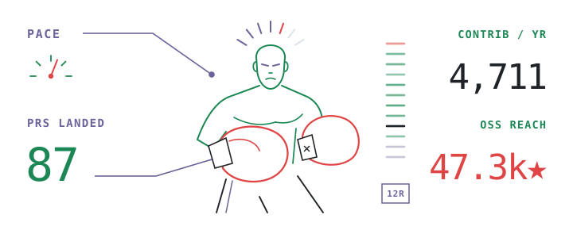

<a href="https://github.com/search?q=author%3ASmitMachhi+is%3Apr+-user%3ASmitMachhi+-user%3Athecaptainsmit&type=pullrequests"><picture><source media="(prefers-color-scheme: dark)" srcset="stats/boxer-dark.svg"></picture></a>

